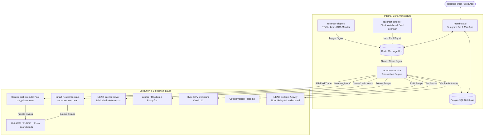

# RacerBot 🏎️💨

> **A high-speed cross-chain trading terminal, confidential execution engine, and social copy-trading platform for NEAR Protocol, Solana, HyperEVM, and Sui — directly inside Telegram and on the web.**

[](https://near.org)
[](https://solana.com)
[](https://hyperliquid.xyz)
[](https://sui.io)
[](https://www.typescriptlang.org/)
[](https://www.rust-lang.org/)
[](https://opensource.org/licenses/MIT)

---

## 📖 Table of Contents

- [NEAR HACKATHON Submission](#near-hackathon-submission)
- [What is RacerBot?](#-what-is-racerbot)
- [The Problem RacerBot Solves](#-the-problem-racerbot-solves)
- [What RacerBot Does (Core Features)](#-what-racerbot-does-core-features)
  - [⚡ 1-Click Fast Trading](#-1-click-fast-trading)
  - [🛡️ Confidential Trading & Shielded Pools](#️-confidential-trading--shielded-pools)
  - [🌐 NEAR Intents & Chain Abstraction](#-near-intents--chain-abstraction)
  - [👥 RacerAlpha Social Copy-Trading](#-raceralpha-social-copy-trading)
  - [🚀 RaceFleet Multi-Wallet Engine](#-racefleet-multi-wallet-engine)
  - [🎯 First-Block Token Sniping](#-first-block-token-sniping)
  - [🛡️ Anti-Rug & Safety Screening](#️-anti-rug--safety-screening)
  - [🤖 Order Automation (TP / SL / DCA / Limit)](#-order-automation-tp--sl--dca--limit)
  - [💼 Portfolio Management & Live On-Chain Sync](#-portfolio-management--live-on-chain-sync)
  - [📢 Community Buy Bot Alerts](#-community-buy-bot-alerts)
  - [🏛️ NEAR Builders Activity Protocol](#️-near-builders-activity-protocol)
- [How It Works (System Architecture & Trade Lifecycle)](#-how-it-works-system-architecture--trade-lifecycle)
  - [1. Managed Wallet Key Model](#1-managed-wallet-key-model)
  - [2. The Lifecycle of a Swap](#2-the-lifecycle-of-a-swap)
  - [3. Confidential Execution Pool Flow](#3-confidential-execution-pool-flow)
  - [4. How the Sniper & Pool Detector Work](#4-how-the-sniper--pool-detector-work)
  - [5. Automated Risk Triggers (TP/SL, Limit, DCA)](#5-automated-risk-triggers-tpsl-limit-dca)
- [Architecture Diagram](#-architecture-diagram)
- [Supported Chains & Venues](#-supported-chains--venues)
- [Security & Risk Model](#-security--risk-model)
- [Monorepo Package Structure](#-monorepo-package-structure)
- [Getting Started & Local Development](#-getting-started--local-development)
  - [Prerequisites](#prerequisites)
  - [Installation & Setup](#installation--setup)
  - [Smart Contract Compilation](#smart-contract-compilation)
  - [Running the Services](#running-the-services)
- [Deployment](#-deployment)
- [Community & Socials](#-community--socials)

---

## NEAR HACKATHON Submission

RacerBot is built on NEAR Protocol, leveraging native smart contracts, NEAR Intents, and shielded execution. Per the hackathon rules (Q-003, Q-004), only work within the designated timeline is evaluated for judging:

- **Baseline:** tag [`pre-hackathon`](https://github.com/igboze/racerbot/tree/pre-hackathon) (2026-10-19). Everything up to this tag is pre-existing work.
- **Hackathon work:** [`pre-hackathon...main`](https://github.com/igboze/racerbot/compare/pre-hackathon...main).
- **Core NEAR Innovations Built During the Window:**
  - **NEAR Router Contract** (`packages/contract`, deployed at `racerbotrouter.near`): Atomic multi-hop routing, swap output measured via per-swap balance delta, token serialisation, and fail-safe refund vaults.
  - **Confidential Trading Pool**: Isolated `bot_private` per-position executor subaccounts breaking on-chain tracing between trader identity and token order flow.
  - **NEAR Intents & 1Click Cross-Chain Solver**: Frictionless deposits and native cross-chain swaps powered by `1click.chaindefuser.com` / `intents.near` with hybrid DCL multi-hop fallback.
  - **RacerAlpha Creator Economy**: On-chain subscription billing with instant 95% creator payouts via NEAR smart contract / vault payouts.
  - **RaceFleet Multi-Wallet Engine**: Parallel execution across up to 10 sub-wallets for stealth accumulation and multi-wallet exits.
- **Other chains (disclosure, Q-002):** Sui, Solana and Starknet wallet code (`packages/shared/src/sui.ts`, `solana.ts`, `starknet.ts`, `packages/api/src/solanaFleet.ts`, `starknetAlerts.ts`) are pre-existing and not part of the NEAR submission.
- **Libraries and AI assistance (Q-005):** near-sdk (Rust), near-api-js, Express, PostgreSQL, Redis, D3. Parts of the code were developed with AI coding assistants.

---

## 💡 What is RacerBot?

**RacerBot** is an automated, lightning-fast decentralized trading terminal built for Telegram and Web. It empowers traders to buy, sell, snipe, copy-trade, and automate orders across **NEAR Protocol**, **Solana**, **HyperEVM**, and **Sui** without ever leaving Telegram.

Instead of wrestling with slow web DEX interfaces, approving endless wallet popups, calculating gas and slippage, or missing new token bonding curves, RacerBot executes trades in milliseconds: from instant 1-click swaps and confidential stealth execution to automated first-block pool snipes and trailing stop-losses.

---

## ⚠️ The Problem RacerBot Solves

1. **Sluggish Web Interfaces & Friction**: Browser DEXs require multiple page reloads, wallet approvals, and storage registration popups, causing traders to miss fast-moving market opportunities.
2. **Launchpad & Chain Fragmentation**: Liquidity on NEAR and Solana is fragmented across dozens of launchpads (Ref AMM/DCL, Rhea, MemeCooking, ShardsMarket, Intear, Raydium, Pump.fun). Finding active pools requires tedious manual research.
3. **MEV & On-Chain Copycat Tracking**: When profitable traders swap on public DEXs, MEV bots and copycat scanners track their wallet addresses, frontrunning their entries and copying their exits.
4. **Lack of Automated Risk Tools**: Native DEXs lack centralized exchange features—such as automated Stop-Loss, Take-Profit targets, Limit Orders, and recurring DCA.
5. **Honeypots & Rug Pulls**: Malicious contracts lock liquidity, set 100% sell taxes, or hold concentrated developer supply, trapping regular traders.

**RacerBot solves these** with managed trading subaccounts, an atomic routing engine, shielded confidential executor pools, automated anti-rug filters, bubble map visualizations, and autonomous order workers.

---

## ✨ What RacerBot Does (Core Features)

### ⚡ 1-Click Fast Trading
- Paste any token contract address (CA) or ticker to instantly view real-time market cap, price, liquidity, bonding progress, and charts.
- Execute buys and sells in one tap with customizable presets (`0.5 NEAR`, `1 NEAR`, `5 NEAR`, `25%`, `50%`, `100%`, or custom amounts).
- Dynamic slippage optimization and automatic storage deposit registration so transactions never fail due to unregistered NEP-141 storage.

### 🛡️ Confidential Trading & Shielded Pools
- **Break On-Chain Tracing**: Uses ephemeral, rotating `bot_private` per-position executor subaccounts on NEAR.
- **MEV & Copycat Protection**: The public transaction graph only sees calls between the executor pool and the router, shielding your main trading identity from on-chain scanners and predatory front-running bots.
- Positions are managed and settled privately back to your trading vault upon exit.

### 🌐 NEAR Intents & Chain Abstraction
- **1Click Cross-Chain Solver**: Deposit from Ethereum, Arbitrum, Base, Solana, or Bitcoin directly into NEAR native assets via `1click.chaindefuser.com` / `intents.near`.
- **Hybrid Routing**: Combines intent-based quotes with local Ref Finance DCL concentrated liquidity and Rhea AMM pools to guarantee the best fill price with zero manual bridging.

### 👥 RacerAlpha Social Copy-Trading
- **Alpha Creator Marketplace**: Top traders and signal callers can launch private alpha channels with customizable monthly subscription pricing (in NEAR/USDC) and performance fees.
- **Instant Creator Revenue Split**: On-chain smart contract / vault payouts instantly distribute 95% of subscription revenue to the creator.
- **Automated Copy Execution**: Followers configure replication rules (fixed amount or percentage, max slippage, stop-loss), and RacerBot mirrors the leader's buys and sells with sub-second execution.

### 🚀 RaceFleet Multi-Wallet Engine
- **Stealth Fleet Accumulation**: Create, manage, and fund up to 10 sub-wallets simultaneously from a single master dashboard.
- **Bundle Buys & Sells**: Split buys across all fleet wallets in parallel transactions, breaking up large orders to prevent market slippage and frontrunning.
- **1-Click Token Consolidation**: Sweep all fleet token balances back into your main wallet with a single tap.

### 🎯 First-Block Token Sniping
- **Launchpad Pool Sniping**: Place snipe orders on upcoming token launches. When the detector identifies pool initialization, RacerBot submits the buy instantly.
- **Deployer Auto-Sniping**: Automatically snipe tokens launched by specific creator accounts matching your liquidity thresholds and max market cap filters.
- **Pre-Warmed Storage**: Proactively registers user token storage on-chain before token launches, saving critical milliseconds during competitive pool openings.

### 🛡️ Anti-Rug & Safety Screening
- **Fail-Closed Honeypot Detection**: Simulates sell execution, checks creator balance percentages, and scans contract bytecode for malicious transfer fees before executing auto-buys.
- **Interactive Sybil & Bubblemap Viewer**: Visual holder cluster inspector identifies sybil networks, creator wallets, and insider holder concentrations before entering a position.

### 🤖 Order Automation (TP / SL / DCA / Limit)
- **Take-Profit & Stop-Loss (TP/SL)**: Multi-tier percentage triggers (e.g., sell 50% at +100%, sell remainder at -20%) continuously monitored by background workers.
- **Limit Orders**: Set target buy and sell prices. Orders execute on-chain when the market reaches your target.
- **Dollar-Cost Averaging (DCA)**: Schedule automated recurring buys (e.g., buy 2 NEAR every 4 hours for 7 days) to smooth out volatility.

### 💼 Portfolio Management & Live On-Chain Sync
- **Multi-Chain Wallet Hub**: Create, import, switch, export private keys, and manage NEAR, Solana, EVM, and Sui wallets.
- **Live On-Chain Balance Sync**: Real-time RPC reconciliation reflects external transfers and DEX trades instantly, clearing empty positions automatically.
- **Shareable PnL Cards**: Generates high-resolution social PnL cards displaying ROI percentages, profit in native tokens, hold duration, and token badges.

### 📢 Community Buy Bot Alerts
- Add RacerBot to Telegram groups to track token buys in real-time. Features animated buy steps, market cap trackers, whale alerts, customizable media banners, and instant buy shortcuts.

### 🏛️ NEAR Builders Activity Protocol
- Cryptographically signs and publishes on-chain activity events (`trade.buy`, `trade.sell`, `snipe.executed`) to Nostr relays via the [NEAR Builders Activity protocol](https://activity.nearbuilders.org), allowing traders to earn verifiable ecosystem reputation.

---

## ⚙️ How It Works (System Architecture & Trade Lifecycle)

### 1. Managed Wallet Key Model

Each user receives managed trading accounts across supported chains (e.g. `<id>.racerbot.near` on NEAR, native keypairs on Solana, EVM, and Sui).

- Keys are generated server-side with cryptographic entropy, encrypted using **AES-256-GCM** with authenticated tags (`KEY_ENCRYPTION_MASTER_KEY`), and stored in PostgreSQL.
- The master key is read strictly from runtime environment variables and is never exposed in the codebase.
- Users have full sovereignty: private keys can be exported at any time via `/wallet -> Export Key` for use in external wallets (Meteor, Phantom, MetaMask, Slingshot).

---

### 2. The Lifecycle of a Swap

```
[1. User Action]      ──► User taps "Buy 5 NEAR" or submits a CA
       │
[2. Route & Quote]    ──► Parallel quote engine queries NEAR Intents (1Click), 
       │                  Ref AMM, Ref DCL, Rhea, and launchpad curves (<80ms)
       │
[3. Safety Check]     ──► Honeypot engine checks contract supply concentration,
       │                  freeze authorities, and creator balances
       │
[4. Atomic Router]    ──► Constructs transaction for Rust contract (racerbotrouter.near)
       │                  Batches wrap_near + storage_deposit + swap + fee deduction
       │
[5. Hedged Multi-RPC] ──► Broadcasts signed transaction to FastNEAR, QuickNode, and
       │                  public endpoints simultaneously. First confirmation wins.
       │
[6. Settlement]       ──► Records fill in Postgres, calculates cost basis & PnL,
                          fires Telegram notification, and publishes Activity event
```

---

### 3. Confidential Execution Pool Flow

```
User Trading Request (Telegram)
           │
           ▼
[Confidential Dispatcher]
           │
           ├─► Allocates ephemeral `bot_private_<hash>.near` executor
           ├─► Funds executor from shielded pool vault
           │
           ▼
[Isolated Swap Execution]
           │
           ├─► Executor calls `racerbotrouter.near`
           ├─► Swap settles directly with DEX / Launchpad
           │
           ▼
[Settlement & Shielding]
           │
           └─► Output tokens or profits return to user's trading vault
               On-chain scanners only see executor <-> router activity!
```

---

### 4. How the Sniper & Pool Detector Work

```
┌──────────────────────────┐
│     racerbot-detector    │  Streams live blocks from NEAR RPC websockets
└─────────────┬────────────┘
              │ 1. Watches factory receipts (ShardsMarket, Rhea, MemeCooking, etc.)
              │ 2. Detects pool initialization or liquidity addition
              ▼
┌──────────────────────────┐
│        Redis Bus         │  Publishes AUTO_BUY_SIGNAL event
└─────────────┬────────────┘
              │ 3. Instant signal dispatch (<5ms)
              ▼
┌──────────────────────────┐
│     racerbot-executor    │  Pulls pre-warmed account key & pre-computed quote
└─────────────┬────────────┘
              │ 4. Signs & broadcasts atomic swap transaction
              ▼
┌──────────────────────────┐
│      NEAR Blockchain     │  Transaction included in the first available block
└──────────────────────────┘
```

---

### 5. Automated Risk Triggers (TP/SL, Limit, DCA)

- **`racerbot-triggers`** runs high-frequency background event loops monitoring live DEX prices against all active user orders.
- When an asset price crosses a Take-Profit or Stop-Loss threshold, the trigger service immediately dispatches an execution signal.
- DCA schedules execute recurring orders at user-specified intervals with automated balance verification.
- Limit orders monitor orderbook liquidity and fill automatically when price conditions are satisfied.

---

## 🏛️ Architecture Diagram



---

## 🌐 Supported Chains & Venues

| Chain | Venue / Protocol | Type | Supported Operations |
|---|---|---|---|
| **NEAR** | **Ref Finance** | AMM v2 & DCL Concentrated Liquidity | Instant Swaps, Multi-Hop Routing, Limit Orders |
| **NEAR** | **NEAR Intents** | 1Click Cross-Chain Solver (`chaindefuser`) | Cross-Chain Deposits, Intent-Based Swaps |
| **NEAR** | **Rhea DEX** | Bonded & Pre-Bonded AMM | Instant Swaps, Pool Sniping, Auto-Buy |
| **NEAR** | **ShardsMarket** | Bonding Curve Launchpad | Real-Time Pool Sniping, Swaps |
| **NEAR** | **NearlyTrade** | Curve Factory & DEX | Token Trading, Liquidity Routing |
| **NEAR** | **Intear** | Launchpad & AMM | Instant Swaps, Bonding Curve Trades |
| **NEAR** | **MemeCooking** | Bonding Curve Protocol | Token Snipes, Curve Swaps |
| **NEAR** | **OneTokenHub** | Launchpad Protocol | Curve Swaps, Direct Swaps |
| **NEAR** | **Gaypad / Nearpad** | Launchpad AMM | Pre-Bonded Curve Trading |
| **NEAR** | **ShoreMarkets / Kelytra** | Token Curve Factory | New Pool Sniping, Curve Trading |
| **NEAR** | **NearPumpFun** | Pump Bonding Curves | Instant Snipes, Curve Trading |
| **Solana** | **Jupiter** | DEX Aggregator | Best-Route Multi-Hop Swaps |
| **Solana** | **Raydium** | AMM & Concentrated Liquidity | Instant Swaps, Limit Orders |
| **Solana** | **Pump.fun** | Bonding Curve Protocol | Instant Sniping, Auto-Buy, Migration Tracking |
| **HyperEVM** | **Hyperliquid EVM** | EVM L1 Execution | Fast EVM Swaps, Token Trading |
| **Elysium** | **Kinetiq L2** | EVM L2 Rollup | Low-Gas Swaps, Liquidity Pools |
| **Sui** | **Cetus Protocol** | Concentrated Liquidity DEX | Best-Price Swap Execution |
| **Sui** | **Hop.ag** | Multi-DEX Aggregator | Best-Route Aggregation |
| **Sui** | **Sui pump.fun** | Bonding Curve AMM | Curve Swaps, Wallet Management |

---

## 🛡️ Security & Risk Model

1. **Managed Wallets & Encryption**: Stored keys are encrypted with AES-256-GCM using authenticated tags. The master key is loaded strictly from environment variables at runtime.
2. **Confidential Isolation**: Ephemeral executor subaccounts isolate user trades on-chain, preventing wallet surveillance and predatory frontrunning.
3. **Fail-Safe Router Accounting**: The router contract (`racerbotrouter.near`) verifies balances pre- and post-swap. If a swap fails or returns less than minimum slippage, funds are refunded to the user vault.
4. **Hedged Multi-RPC Broadcaster**: Sends signed transactions to multiple independent RPC providers (FastNEAR, QuickNode, public nodes) simultaneously, preventing single-node failures or censorship.
5. **Continuous On-Chain Verification**: Positions are continually validated against real on-chain contract states to prevent phantom positions or stale balances.

---

## 📂 Monorepo Package Structure

The repository is structured as a **Turborepo** monorepo:

| Package | Path | Purpose |
|---|---|---|
| **`@racerbot/api`** | [`packages/api`](packages/api) | Telegram bot handlers, command routing, Mini App API, PnL card rendering, buy bot alerts. |
| **`@racerbot/detector`** | [`packages/detector`](packages/detector) | Real-time block stream monitor scanning for new tokens and liquidity additions. |
| **`@racerbot/executor`** | [`packages/executor`](packages/executor) | Transaction builder, hedged multi-RPC broadcaster, fill recording, and fee ledger. |
| **`@racerbot/triggers`** | [`packages/triggers`](packages/triggers) | Polling engine for Take-Profit, Stop-Loss, Limit Orders, and scheduled DCA tasks. |
| **`@racerbot/contract`** | [`packages/contract`](packages/contract) | Rust smart contract (`racerbot-router`) compiled to `wasm32-unknown-unknown`. |
| **`@racerbot/db`** | [`packages/db`](packages/db) | PostgreSQL schema, migrations, connection pools, and query repositories. |
| **`@racerbot/shared`** | [`packages/shared`](packages/shared) | Shared cryptography, multi-RPC client, Redis pub/sub, Solana/EVM/Sui clients, Activity protocol. |

---

## 🛠️ Getting Started & Local Development

### Prerequisites

- **Node.js**: `v20.x` or later (tested on Node `v22` / `v25`)
- **Rust**: `1.95.0` with `wasm32-unknown-unknown` target (for compiling the contract)
- **PostgreSQL**: `15+`
- **Redis**: `7+`

### Installation & Setup

1. **Clone the repository**:
   ```bash
   git clone https://github.com/igboze/racerbot.git
   cd racerbot
   ```

2. **Install all workspace dependencies**:
   ```bash
   npm install
   ```

3. **Configure Environment Variables**:
   ```bash
   cp .env.example .env
   ```
   Fill in your configuration details in `.env`:
   - `DATABASE_URL`: Connection string to your PostgreSQL instance.
   - `REDIS_URL`: Connection string to your Redis server.
   - `TELEGRAM_BOT_TOKEN`: Bot token from Telegram's `@BotFather`.
   - `KEY_ENCRYPTION_MASTER_KEY`: 64-character hex string for AES-256-GCM encryption.
   - `ROUTER_CONTRACT_ID`: Mainnet router contract ID (`racerbotrouter.near`).
   - `RPC_PROVIDERS`: Comma-separated list of NEAR RPC endpoints (e.g. FastNEAR, QuickNode).
   - `NEAR_INTENTS_API_URL`: NEAR Intents API solver endpoint (`https://1click.chaindefuser.com`).

4. **Run Database Migrations**:
   ```bash
   npm run build --workspace=@racerbot/db
   npm run migrate --workspace=@racerbot/db
   ```

5. **Build the Full Monorepo**:
   ```bash
   npx turbo run build
   ```

---

### Smart Contract Compilation

The smart contract is written in Rust and compiled to WebAssembly:

```bash
# Build the contract WASM
npm run build --workspace=@racerbot/contract

# Run unit and integration tests
cd packages/contract
cargo test
```

---

### Running the Services

You can run individual microservices in separate terminals:

```bash
# Terminal 1: Telegram Bot & Mini App Backend
npm run dev:api

# Terminal 2: Block Watcher & Pool Detector
npm run dev:detector

# Terminal 3: Trade & Snipe Execution Engine
npm run dev:executor

# Terminal 4: Automated Triggers (TP/SL, DCA, Limit Orders)
npm run dev:triggers
```

---

## 🚢 Deployment

RacerBot microservices are containerized with dedicated Dockerfiles in `docker/`:

```bash
# Build Docker images
docker build -f docker/Dockerfile.api -t racerbot-api .
docker build -f docker/Dockerfile.detector -t racerbot-detector .
docker build -f docker/Dockerfile.executor -t racerbot-executor .
docker build -f docker/Dockerfile.triggers -t racerbot-triggers .
```

To deploy directly to **Railway**:
```bash
bash scripts/deploy.sh
```

---

## 🤝 Community & Socials

- **Telegram Bot**: [@racertradingbot](https://t.me/racertradingbot)
- **Community Chat**: [t.me/racerbot_community](https://t.me/racerbot_community)
- **Announcements**: [t.me/racertrading](https://t.me/racertrading)
- **Twitter / X**: [@racertradingbot](https://x.com/racertradingbot)
- **Ecosystem Activity**: [activity.nearbuilders.org](https://activity.nearbuilders.org/activity-sources)

---

## 📄 License

This project is licensed under the [MIT License](LICENSE).
