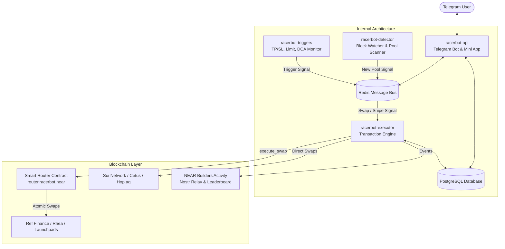

# RacerBot 🏎️💨

> **A non-custodial, high-performance automated trading terminal for NEAR Protocol and Sui Network, directly inside Telegram.**

[](https://near.org)
[](https://sui.io)
[](https://www.typescriptlang.org/)
[](https://www.rust-lang.org/)
[](https://opensource.org/licenses/MIT)

---

## 📖 Table of Contents

- [What is RacerBot?](#-what-is-racerbot)
- [The Problem RacerBot Solves](#-the-problem-racerbot-solves)
- [What RacerBot Does (Core Features)](#-what-racerbot-does-core-features)
- [How It Works (System Architecture & Trade Lifecycle)](#-how-it-works-system-architecture--trade-lifecycle)
  - [1. Non-Custodial Key Architecture](#1-non-custodial-key-architecture)
  - [2. The Lifecycle of a Swap](#2-the-lifecycle-of-a-swap)
  - [3. How the Sniper & Pool Detector Work](#3-how-the-sniper--pool-detector-work)
  - [4. Automated Risk Triggers (TP/SL, Limit, DCA)](#4-automated-risk-triggers-tpsl-limit-dca)
- [Architecture Diagram](#-architecture-diagram)
- [Supported Exchanges & Launchpads](#-supported-exchanges--launchpads)
- [Security & Risk Model](#-security--risk-model)
- [Monorepo Package Structure](#-monorepo-package-structure)
- [Getting Started & Local Development](#-getting-started--local-development)
  - [Prerequisites](#prerequisites)
  - [Installation & Setup](#installation--setup)
  - [Smart Contract Compilation](#smart-contract-compilation)
  - [Running the Services](#running-the-services)
- [Deployment](#-deployment)
- [Community & Socials](#-community--socials)

---

## 💡 What is RacerBot?

**RacerBot** is an automated, lightning-fast decentralized trading terminal built for Telegram and Web. It allows traders to buy, sell, snipe, and automate trades across **NEAR Protocol** and the **Sui Network** without leaving Telegram and without sacrificing custody of their funds.

Instead of navigating sluggish web browser DEX interfaces, manually approving wallet popups, calculating slippage, or missing new token bonding curves, RacerBot handles the entire trading pipeline in milliseconds: from instant 1-click swaps to automated first-block pool snipes and trailing stop-losses.

---

## ⚠️ The Problem RacerBot Solves

Trading meme tokens and fast-moving decentralized launchpads on mobile has traditionally been a painful experience:
1. **Sluggish Web Interfaces**: Browser-based DEXs require multiple page reloads, wallet approvals, and storage registration popups, causing traders to miss volatile price moves.
2. **Launchpad Fragmentation**: Liquidity on NEAR and Sui is spread across dozens of launchpad factories (Ref, Rhea, MemeCooking, ShardsMarket, NearlyTrade, Cetus, Hop.ag). Finding where a token trades requires manual research.
3. **No Risk Automation**: Native DEXs lack basic centralized exchange tools—such as automated Stop-Loss, Take-Profit targets, Limit Orders, and recurring DCA.
4. **Honeypots & Rug Pulls**: Malicious developers lock liquidity, set 100% sell taxes, or hold massive developer supply, leaving regular traders stranded.
5. **Custodial Trade-Off**: Traditional trading bots often require users to send their private keys directly to a centralized server, exposing their entire balance to theft or server compromise.

**RacerBot solves all of these** by pairing **client-side non-custodial keys** with a **pre-warmed atomic routing engine**, automated honeypot filters, visual holder bubble maps, and complete order automation.

---

## ✨ What RacerBot Does (Core Features)

### ⚡ 1-Click Fast Trading
- Paste any token contract address (CA) or ticker to instantly view real-time market cap, price, liquidity, bonding progress, and charts.
- Execute buys and sells in one tap with customizable presets (`0.5 NEAR`, `1 NEAR`, `5 NEAR`, `25%`, `50%`, `100%`, or custom amounts).
- Dynamic slippage optimization and automatic storage deposit registration so transactions never fail due to unregistered NEP-141 storage.

### 🎯 First-Block Token Sniping
- **Launchpad Pool Sniping**: Place snipe orders on upcoming token launches. The moment a pool is initialized, RacerBot executes in the very same block.
- **Deployer Auto-Sniping**: Automatically snipe tokens launched by specific creator accounts matching your customized liquidity thresholds and max market cap limits.
- **Pre-Warmed Storage**: Proactively registers user token storage on-chain before the token launches, saving critical milliseconds during competitive pool openings.

### 🛡️ Anti-Rug & Safety Screening
- **Fail-Closed Honeypot Detection**: Evaluates whether a token allows selling, verifies token creator balances, and verifies whether the contract holds a dangerous percentage of supply before allowing auto-buys.
- **Interactive Sybil & Bubblemap Viewer**: Built-in visual holder cluster inspector identifies sybil networks, creator wallets, and insider holder concentrations before you enter a position.

### 🤖 Order Automation (TP / SL / DCA / Limit Orders)
- **Take-Profit & Stop-Loss (TP/SL)**: Configure multi-tier percentage triggers (e.g., sell 50% at +100%, sell remainder at -20%). Monitored continuously in background workers.
- **Limit Orders**: Set target buy and sell prices. Orders execute automatically on-chain when the market reaches your designated price.
- **Dollar-Cost Averaging (DCA)**: Schedule automated recurring buys (e.g., buy 2 NEAR every 4 hours for 7 days) to smooth out volatility.
- **Copy Trading**: Follow master trader wallets and automatically replicate their buys and sells with customized sizing and daily budget caps.

### 💼 Portfolio Management & Live On-Chain Sync
- **Multi-Wallet Support**: Create, import, switch, rename, and manage multiple NEAR and Sui wallets within a single Telegram interface.
- **Live On-Chain Balance Reconciliation**: When you transfer or sell tokens externally using another wallet (such as Meteor, HERE, or NEAR CLI), tapping `🔄 Refresh` or `/holdings` automatically verifies live RPC balances, updates exact quantities, and clears empty positions from your bags list.
- **Shareable PnL Cards**: High-resolution image generator renders branded PnL cards displaying ROI percentages, profit in native tokens, hold duration, and token badges.

### 📢 Group Buy Bot Alerts
- Community admins can add RacerBot to Telegram groups to track token buys in real-time. Features animated buy steps, market cap trackers, whale alerts, customizable media banners, and instant buy shortcuts.

### 🏛️ NEAR Builders Activity Protocol Integration
- Cryptographically signs and publishes on-chain activity events (`trade.buy`, `trade.sell`, `snipe.executed`) to Nostr relays via the [NEAR Builders Activity protocol](https://activity.nearbuilders.org), allowing traders to earn verifiable ecosystem reputation and climb public leaderboards.

---

## ⚙️ How It Works (System Architecture & Trade Lifecycle)

### 1. Non-Custodial Key Architecture

RacerBot uses a dual-key model to ensure your funds can **never** be stolen:

```
┌────────────────────────────────────────────────────────┐
│                   User's Browser / Mini App            │
│  • Generates Full-Access Keypair (Seed Phrase)         │
│  • Seed phrase is shown ONCE to user and NEVER saved   │
│  • Creates a Function-Call Scoped Access Key           │
└──────────────────────────┬─────────────────────────────┘
                           │ Grants permission ONLY to:
                           │ Contract: router.racerbot.near
                           │ Method:   execute_swap
                           │ Allowance: 0.5 - 2.0 NEAR
                           ▼
┌────────────────────────────────────────────────────────┐
│                   RacerBot Backend                     │
│  • Stores ONLY the encrypted Function-Call Key         │
│  • CANNOT transfer native NEAR to other accounts       │
│  • CANNOT call any method other than execute_swap      │
│  • CANNOT delete keys or add new keys                  │
└────────────────────────────────────────────────────────┘
```

Because the backend holds only a **scoped function-call key**, even in the impossible event of a server compromise, an attacker **cannot** withdraw your NEAR or transfer your tokens to an external wallet.

---

### 2. The Lifecycle of a Swap

When you tap **Buy** or **Sell**, RacerBot executes the trade through the following pipeline:

```
[1. User Action]  ──► User taps "Buy 5 NEAR" in Telegram
       │
[2. Route & Quote] ──► Multi-venue quote engine queries Ref AMM, Ref DCL, Rhea, 
       │               and launchpad curves in parallel (<80ms)
       │
[3. Safety Check]  ──► Honeypot engine checks contract supply concentration,
       │               freeze authorities, and creator balances
       │
[4. Atomic Router] ──► Constructs transaction for Rust contract (router.racerbot.near)
       │               Batches wrap_near + storage_deposit + swap + fee deduction
       │
[5. Hedged Multi-RPC]► Broadcasts signed transaction to FastNEAR, QuickNode, and
       │               public endpoints simultaneously. First confirmation wins.
       │
[6. Settlement]    ──► Records trade fill in Postgres, calculates cost basis & PnL,
                       fires Telegram notification, and publishes Activity event
```

---

### 3. How the Sniper & Pool Detector Work

```
┌──────────────────────────┐
│     racerbot-detector    │  Streams live blocks from NEAR RPC websockets
└─────────────┬────────────┘
              │ 1. Watches factory receipts (ShardsMarket, Rhea, MemeCooking, etc.)
              │ 2. Detects pool initialization or liquidity addition
              ▼
┌──────────────────────────┐
│        Redis Bus         │  Publishes AUTO_BUY_SIGNAL event
└─────────────┬────────────┘
              │ 3. Instant signal dispatch (<5ms)
              ▼
┌──────────────────────────┐
│     racerbot-executor    │  Pulls pre-warmed account key & pre-computed quote
└─────────────┬────────────┘
              │ 4. Signs & broadcasts atomic swap transaction
              ▼
┌──────────────────────────┐
│      NEAR Blockchain     │  Transaction lands in the FIRST block of pool launch!
└──────────────────────────┘
```

---

### 4. Automated Risk Triggers (TP/SL, Limit, DCA)

- **`racerbot-triggers`** runs background event loops monitoring live DEX prices against all active user orders.
- When an asset price crosses a Take-Profit or Stop-Loss threshold, the trigger service immediately dispatches a sell signal to the executor.
- DCA schedules execute recurring orders at user-specified intervals with automated balance verification.
- Limit orders monitor orderbook liquidity and fill automatically when price boundaries are met.

---

## 🏛️ Architecture Diagram



---

## 🌐 Supported Exchanges & Launchpads

| Chain | Venue / Protocol | Type | Supported Operations |
|---|---|---|---|
| **NEAR** | **Ref Finance** | AMM v2 & DCL Concentrated Liquidity | Instant Swaps, Multi-Hop Routing, Limit Orders |
| **NEAR** | **Rhea DEX** | Bonded & Pre-Bonded AMM | Instant Swaps, Pool Sniping, Auto-Buy |
| **NEAR** | **ShardsMarket** | Bonding Curve Launchpad | Real-Time Pool Sniping, Swaps |
| **NEAR** | **NearlyTrade** | Curve Factory & DEX | Token Trading, Liquidity Routing |
| **NEAR** | **Intear** | Launchpad & AMM | Instant Swaps, Bonding Curve Trades |
| **NEAR** | **MemeCooking** | Bonding Curve Protocol | Token Snipes, Curve Swaps |
| **NEAR** | **OneTokenHub** | Launchpad Protocol | Curve Swaps, Direct Swaps |
| **NEAR** | **Gaypad / Nearpad** | Launchpad AMM | Pre-Bonded Curve Trading |
| **NEAR** | **ShoreMarkets / Kelytra** | Token Curve Factory | New Pool Sniping, Curve Trading |
| **NEAR** | **NearPumpFun** | Pump Bonding Curves | Instant Snipes, Curve Trading |
| **Sui** | **Cetus Protocol** | Concentrated Liquidity DEX | Best-Price Swap Execution |
| **Sui** | **Hop.ag** | Multi-DEX Aggregator | Best-Route Aggregation |
| **Sui** | **Sui pump.fun** | Bonding Curve AMM | Curve Swaps, Wallet Management |

---

## 🛡️ Security & Risk Model

RacerBot enforces bank-grade security protocols:

1. **Zero Full-Access Keys on Server**: Seed phrases and full-access keys never leave the client's device.
2. **Strict Method Scoping**: Scoped keys can only invoke `execute_swap` on `router.racerbot.near`. Any attempt to call unauthorized methods fails at the consensus level.
3. **Restricted Allowance**: Scoped access keys carry an allowance (default 0.5 NEAR to 2.0 NEAR) used purely for transaction gas.
4. **AES-256-GCM Encryption**: All access keys stored in the database are encrypted using AES-256-GCM with authenticated tags.
5. **Atomic Fee Skimming**: Router fees are collected atomically in the swap transaction. If a swap fails or reverts, zero fee is charged.
6. **Live Balance Verification**: Positions are continually validated against real on-chain contract states to prevent phantom positions or stale balances.

---

## 📂 Monorepo Package Structure

The repository is structured as a **Turborepo** monorepo:

| Package | Path | Purpose |
|---|---|---|
| **`@racerbot/api`** | [`packages/api`](file:///c:/Users/Igboze/racerbot/racerbot/packages/api) | Telegram bot handlers, command routing, Mini App API, PnL card rendering, buy bot alerts. |
| **`@racerbot/detector`** | [`packages/detector`](file:///c:/Users/Igboze/racerbot/racerbot/packages/detector) | Real-time block stream monitor scanning for new tokens and liquidity additions. |
| **`@racerbot/executor`** | [`packages/executor`](file:///c:/Users/Igboze/racerbot/racerbot/packages/executor) | Transaction builder, hedged multi-RPC broadcaster, fill recording, and fee ledger. |
| **`@racerbot/triggers`** | [`packages/triggers`](file:///c:/Users/Igboze/racerbot/racerbot/packages/triggers) | Polling engine for Take-Profit, Stop-Loss, Limit Orders, and scheduled DCA tasks. |
| **`@racerbot/contract`** | [`packages/contract`](file:///c:/Users/Igboze/racerbot/racerbot/packages/contract) | Rust smart contract (`racerbot-router`) compiled to `wasm32-unknown-unknown`. |
| **`@racerbot/db`** | [`packages/db`](file:///c:/Users/Igboze/racerbot/racerbot/packages/db) | PostgreSQL schema, migrations, connection pools, and query repositories. |
| **`@racerbot/shared`** | [`packages/shared`](file:///c:/Users/Igboze/racerbot/racerbot/packages/shared) | Shared cryptography, multi-RPC client, Redis pub/sub, Sui client, Activity protocol. |

---

## 🛠️ Getting Started & Local Development

### Prerequisites

- **Node.js**: `v20.x` or later (tested on Node `v22` / `v25`)
- **Rust**: `1.95.0` with `wasm32-unknown-unknown` target (for compiling the contract)
- **PostgreSQL**: `15+`
- **Redis**: `7+`

### Installation & Setup

1. **Clone the repository**:
   ```bash
   git clone https://github.com/igboze/racerbot.git
   cd racerbot
   ```

2. **Install all workspace dependencies**:
   ```bash
   npm install
   ```

3. **Configure Environment Variables**:
   ```bash
   cp .env.example .env
   ```
   Fill in your configuration details in `.env`:
   - `DATABASE_URL`: Connection string to your PostgreSQL instance.
   - `REDIS_URL`: Connection string to your Redis server.
   - `TELEGRAM_BOT_TOKEN`: Bot token from Telegram's `@BotFather`.
   - `KEY_ENCRYPTION_MASTER_KEY`: 64-character hex string for AES-256-GCM encryption.
   - `ROUTER_CONTRACT_ID`: Mainnet or testnet router contract ID (`router.racerbot.near`).
   - `RPC_PROVIDERS`: Comma-separated list of NEAR RPC endpoints (e.g. FastNEAR, QuickNode).
   - `NEAR_ACTIVITY_API_KEY`: API key for NEAR Builders Activity integration.

4. **Run Database Migrations**:
   ```bash
   npm run build --workspace=@racerbot/db
   npm run migrate --workspace=@racerbot/db
   ```

5. **Build the Full Monorepo**:
   ```bash
   npx turbo run build
   ```

---

### Smart Contract Compilation

The smart contract is written in Rust and compiled to WebAssembly:

```bash
# Build the contract WASM
npm run build --workspace=@racerbot/contract

# Run unit and integration tests
cd packages/contract
AWS_LC_SYS_PREBUILT_NASM=1 cargo test
```

---

### Running the Services

You can run individual microservices in separate terminals:

```bash
# Terminal 1: Telegram Bot & Mini App Backend
npm run dev:api

# Terminal 2: Block Watcher & Pool Detector
npm run dev:detector

# Terminal 3: Trade & Snipe Execution Engine
npm run dev:executor

# Terminal 4: Automated Triggers (TP/SL, DCA, Limit Orders)
npm run dev:triggers
```

---

## 🚢 Deployment

RacerBot microservices are containerized with dedicated Dockerfiles in `docker/`:

```bash
# Build Docker images
docker build -f docker/Dockerfile.api -t racerbot-api .
docker build -f docker/Dockerfile.detector -t racerbot-detector .
docker build -f docker/Dockerfile.executor -t racerbot-executor .
docker build -f docker/Dockerfile.triggers -t racerbot-triggers .
```

To deploy directly to **Railway**:
```bash
bash scripts/deploy.sh
```

---

## 🤝 Community & Socials

- **Telegram Bot**: [@racertradingbot](https://t.me/racertradingbot)
- **Community Chat**: [t.me/racerbot_community](https://t.me/racerbot_community)
- **Announcements**: [t.me/racertrading](https://t.me/racertrading)
- **Twitter / X**: [@racertradingbot](https://x.com/racertradingbot)
- **Ecosystem Activity**: [activity.nearbuilders.org](https://activity.nearbuilders.org/activity-sources)

---

## 📄 License

This project is licensed under the [MIT License](LICENSE).